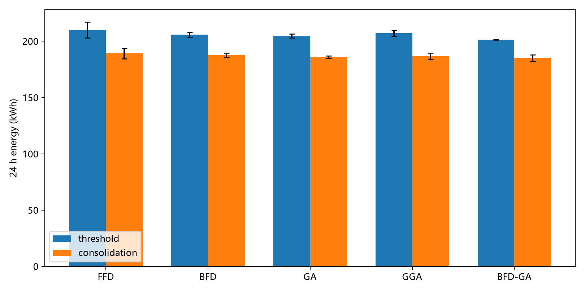

# 研究平台验证结果报告

独立核验：**PASS**；实际案例 1096 组，求解轨迹 27 条。

核验覆盖真实CloudSim事件、VM归属与资源、实际交付工作量、服务器功率、UPS模块损耗和迁移端点功率反馈。PASS表示在声明的模型和参数下实现自洽，不证明作者未公开的实现已被唯一恢复。

全部分组指标见 [aggregate.csv](aggregate.csv)。能耗同时报告服务缺口与每十亿MI实际交付工作量能耗；不能仅凭少服务时的低能耗判定算法更好。三种子标准差描述本次重复波动，不等同于跨日期泛化证据。

## 动态实验

| 场景 | 算法 | kWh均值±标准差 | 迁移均值 | 未交付请求% | kWh/十亿MI |
|---|---|---:|---:|---:|---:|
| n_plus_1_standby_cap0.9_threshold | FFD | 210.076 ± 7.006 | 195.3 | 0.2599 | 67.521 |
| n_plus_1_standby_cap0.9_threshold | BFD | 205.698 ± 2.154 | 233.0 | 0.3742 | 66.190 |
| n_plus_1_standby_cap0.9_threshold | GA | 204.765 ± 1.766 | 237.0 | 0.2131 | 65.784 |
| n_plus_1_standby_cap0.9_threshold | GGA | 206.985 ± 2.728 | 231.7 | 0.2299 | 66.508 |
| n_plus_1_standby_cap0.9_threshold | BFD-GA | 201.378 ± 0.439 | 230.3 | 0.4236 | 64.832 |
| n_plus_1_standby_cap0.9_consolidation | FFD | 189.054 ± 4.556 | 443.7 | 0.5128 | 60.919 |
| n_plus_1_standby_cap0.9_consolidation | BFD | 187.538 ± 1.880 | 482.0 | 0.6332 | 60.504 |
| n_plus_1_standby_cap0.9_consolidation | GA | 185.872 ± 1.129 | 508.7 | 0.4308 | 59.845 |
| n_plus_1_standby_cap0.9_consolidation | GGA | 186.675 ± 2.680 | 512.0 | 0.5177 | 60.156 |
| n_plus_1_standby_cap0.9_consolidation | BFD-GA | 185.033 ± 2.754 | 480.7 | 0.6253 | 59.691 |
| n_plus_1_standby_cap1.0_threshold | FFD | 220.691 ± 3.150 | 205.7 | 0.2772 | 70.946 |
| n_plus_1_standby_cap1.0_threshold | BFD | 221.089 ± 3.861 | 175.7 | 0.3292 | 71.111 |
| n_plus_1_standby_cap1.0_threshold | GA | 213.742 ± 7.860 | 196.3 | 0.1478 | 68.623 |
| n_plus_1_standby_cap1.0_threshold | GGA | 213.742 ± 7.860 | 196.3 | 0.1478 | 68.623 |
| n_plus_1_standby_cap1.0_threshold | BFD-GA | 218.392 ± 1.823 | 172.3 | 0.3116 | 70.231 |
| n_plus_1_standby_cap1.0_consolidation | FFD | 188.557 ± 0.887 | 469.7 | 0.5510 | 60.783 |
| n_plus_1_standby_cap1.0_consolidation | BFD | 190.073 ± 2.593 | 496.0 | 0.6346 | 61.323 |
| n_plus_1_standby_cap1.0_consolidation | GA | 188.286 ± 2.088 | 495.7 | 0.4824 | 60.653 |
| n_plus_1_standby_cap1.0_consolidation | GGA | 188.286 ± 2.088 | 495.7 | 0.4824 | 60.653 |
| n_plus_1_standby_cap1.0_consolidation | BFD-GA | 189.283 ± 1.089 | 469.7 | 0.6049 | 61.050 |
| n_plus_1_shared_cap0.9_threshold | FFD | 213.806 ± 6.993 | 195.3 | 0.2599 | 68.720 |
| n_plus_1_shared_cap0.9_threshold | BFD | 209.441 ± 2.138 | 233.0 | 0.3742 | 67.395 |
| n_plus_1_shared_cap0.9_threshold | GA | 209.175 ± 1.710 | 237.0 | 0.2131 | 67.200 |
| n_plus_1_shared_cap0.9_threshold | GGA | 211.084 ± 2.461 | 231.7 | 0.2299 | 67.825 |
| n_plus_1_shared_cap0.9_threshold | BFD-GA | 205.831 ± 0.436 | 230.3 | 0.4236 | 66.266 |
| n_plus_1_shared_cap0.9_consolidation | FFD | 192.881 ± 4.562 | 443.7 | 0.5128 | 62.152 |
| n_plus_1_shared_cap0.9_consolidation | BFD | 191.373 ± 1.891 | 482.0 | 0.6332 | 61.741 |
| n_plus_1_shared_cap0.9_consolidation | GA | 190.166 ± 1.234 | 508.7 | 0.4308 | 61.227 |
| n_plus_1_shared_cap0.9_consolidation | GGA | 190.668 ± 2.518 | 512.0 | 0.5177 | 61.442 |
| n_plus_1_shared_cap0.9_consolidation | BFD-GA | 189.330 ± 2.659 | 480.7 | 0.6253 | 61.077 |
| n_plus_1_shared_cap1.0_threshold | FFD | 224.384 ± 3.137 | 205.7 | 0.2772 | 72.133 |
| n_plus_1_shared_cap1.0_threshold | BFD | 224.784 ± 3.841 | 175.7 | 0.3292 | 72.299 |
| n_plus_1_shared_cap1.0_threshold | GA | 217.885 ± 7.813 | 196.3 | 0.1478 | 69.953 |
| n_plus_1_shared_cap1.0_threshold | GGA | 217.885 ± 7.813 | 196.3 | 0.1478 | 69.953 |
| n_plus_1_shared_cap1.0_threshold | BFD-GA | 222.554 ± 1.805 | 172.3 | 0.3116 | 71.569 |
| n_plus_1_shared_cap1.0_consolidation | FFD | 192.458 ± 0.946 | 469.7 | 0.5510 | 62.040 |
| n_plus_1_shared_cap1.0_consolidation | BFD | 193.957 ± 2.583 | 496.0 | 0.6346 | 62.576 |
| n_plus_1_shared_cap1.0_consolidation | GA | 192.389 ± 2.140 | 495.7 | 0.4824 | 61.975 |
| n_plus_1_shared_cap1.0_consolidation | GGA | 192.389 ± 2.140 | 495.7 | 0.4824 | 61.975 |
| n_plus_1_shared_cap1.0_consolidation | BFD-GA | 193.539 ± 1.076 | 469.7 | 0.6049 | 62.422 |
| two_n_cap0.9_threshold | FFD | 226.854 ± 6.974 | 195.3 | 0.2599 | 72.914 |
| two_n_cap0.9_threshold | BFD | 222.507 ± 2.114 | 233.0 | 0.3742 | 71.599 |
| two_n_cap0.9_threshold | GA | 223.242 ± 1.629 | 237.0 | 0.2131 | 71.719 |
| two_n_cap0.9_threshold | GGA | 224.684 ± 2.078 | 231.7 | 0.2299 | 72.195 |
| two_n_cap0.9_threshold | BFD-GA | 219.963 ± 0.432 | 230.3 | 0.4236 | 70.815 |
| two_n_cap0.9_consolidation | FFD | 206.074 ± 4.572 | 443.7 | 0.5128 | 66.404 |
| two_n_cap0.9_consolidation | BFD | 204.578 ± 1.908 | 482.0 | 0.6332 | 66.001 |
| two_n_cap0.9_consolidation | GA | 204.058 ± 1.409 | 508.7 | 0.4308 | 65.700 |
| two_n_cap0.9_consolidation | GGA | 204.108 ± 2.281 | 512.0 | 0.5177 | 65.773 |
| two_n_cap0.9_consolidation | BFD-GA | 203.227 ± 2.516 | 480.7 | 0.6253 | 65.560 |
| two_n_cap1.0_threshold | FFD | 237.376 ± 3.118 | 205.7 | 0.2772 | 76.309 |
| two_n_cap1.0_threshold | BFD | 237.777 ± 3.811 | 175.7 | 0.3292 | 76.478 |
| two_n_cap1.0_threshold | GA | 231.551 ± 7.743 | 196.3 | 0.1478 | 74.341 |
| two_n_cap1.0_threshold | GGA | 231.551 ± 7.743 | 196.3 | 0.1478 | 74.341 |
| two_n_cap1.0_threshold | BFD-GA | 236.249 ± 1.778 | 172.3 | 0.3116 | 75.973 |
| two_n_cap1.0_consolidation | FFD | 205.760 ± 1.037 | 469.7 | 0.5510 | 66.328 |
| two_n_cap1.0_consolidation | BFD | 207.236 ± 2.568 | 496.0 | 0.6346 | 66.860 |
| two_n_cap1.0_consolidation | GA | 205.995 ± 2.221 | 495.7 | 0.4824 | 66.358 |
| two_n_cap1.0_consolidation | GGA | 205.995 ± 2.221 | 495.7 | 0.4824 | 66.358 |
| two_n_cap1.0_consolidation | BFD-GA | 207.374 ± 1.059 | 469.7 | 0.6049 | 66.885 |
| feasible_init | FFD | 189.054 ± 4.556 | 443.7 | 0.5128 | 60.919 |
| feasible_init | BFD | 187.538 ± 1.880 | 482.0 | 0.6332 | 60.504 |
| feasible_init | GA | 185.872 ± 1.129 | 508.7 | 0.4308 | 59.845 |
| feasible_init | GGA | 186.675 ± 2.680 | 512.0 | 0.5177 | 60.156 |
| feasible_init | BFD-GA | 185.033 ± 2.754 | 480.7 | 0.6253 | 59.691 |
| total_goal | FFD | 189.054 ± 4.556 | 443.7 | 0.5128 | 60.919 |
| total_goal | BFD | 187.538 ± 1.880 | 482.0 | 0.6332 | 60.504 |
| total_goal | GA | 186.316 ± 0.400 | 477.3 | 0.4783 | 60.016 |
| total_goal | GGA | 187.258 ± 0.873 | 436.7 | 0.4612 | 60.309 |
| total_goal | BFD-GA | 185.033 ± 2.754 | 480.7 | 0.6253 | 59.691 |
| ups_destination | FFD | 187.221 ± 2.939 | 471.7 | 0.5473 | 60.349 |
| ups_destination | BFD | 189.847 ± 1.335 | 448.0 | 0.5282 | 61.184 |
| ups_destination | GA | 185.581 ± 3.130 | 443.7 | 0.4176 | 59.743 |
| ups_destination | GGA | 186.182 ± 2.542 | 477.3 | 0.4319 | 59.945 |
| ups_destination | BFD-GA | 184.505 ± 0.131 | 481.0 | 0.6808 | 59.554 |
| hardware20 | FFD | 189.098 ± 4.547 | 443.7 | 0.5128 | 60.933 |
| hardware20 | BFD | 187.585 ± 1.878 | 482.0 | 0.6332 | 60.519 |
| hardware20 | GA | 185.921 ± 1.123 | 508.7 | 0.4308 | 59.860 |
| hardware20 | GGA | 186.725 ± 2.670 | 512.0 | 0.5177 | 60.172 |
| hardware20 | BFD-GA | 185.079 ± 2.748 | 480.7 | 0.6253 | 59.706 |
| standby20 | FFD | 191.454 ± 4.556 | 443.7 | 0.5128 | 61.693 |
| standby20 | BFD | 189.938 ± 1.880 | 482.0 | 0.6332 | 61.278 |
| standby20 | GA | 188.272 ± 1.129 | 508.7 | 0.4308 | 60.617 |
| standby20 | GGA | 189.075 ± 2.680 | 512.0 | 0.5177 | 60.929 |
| standby20 | BFD-GA | 187.433 ± 2.754 | 480.7 | 0.6253 | 60.465 |

## 图2-24与正文分别比较

图像读数为既有数字化估计，原始读图不确定度也保留。默认轻载整合是工程补充控制规则；其接近正文的结果不能据此反证规则就是作者实现。

| 方法 | 本次kWh | 正文kWh | 正文偏差% | 图像估计kWh | 图像偏差% |
|---|---:|---:|---:|---:|---:|
| FFD | 189.054 | 189.373 | -0.17 | 157.662 | 19.91 |
| BFD | 187.538 | 188.774 | -0.66 | 158.218 | 18.53 |
| GA | 185.872 | 198.476 | -6.35 | 165.994 | 11.98 |
| GGA | 186.675 | 191.372 | -2.45 | 159.743 | 16.86 |
| BFD-GA | 185.033 | 184.980 | 0.03 | 154.536 | 19.73 |

本次三种子能耗均值从低到高为 BFD-GA < GA < GGA < BFD < FFD；BFD-GA位列第1。均值顺序不代表差异统计显著，也不自动证明原文排名恢复。正文与图像基准不能择优使用；15%容差应分别判定。

## 静态加权指标

按表2-1的七档时间占比，分别计算Σw·(1−P提出/P基准)、1−ΣwP提出/ΣwP基准及UPS单独分母指标，见 [weighted_static.csv](weighted_static.csv)。年度能耗仅为本100台服务器模型按全年占比持续运行的条件推算；静态窗口300秒，因此功率换算系数为12。负节省率保留，不调整数据恢复排名。

论文年度货币成本所用产业规模、费率与分母未完整公开，不能以本平台能耗直接证明原文成本优势。27条固定代数求解轨迹也不能替代作者未公开停止条件的图2-26速度结论。

## 适用边界

默认0W备用损耗和0W附加迁移硬件功率是未测定项的下界假设；20W敏感性场景不代表实测参数。CPU复制开销已经进入服务器功率与UPS负载。当前未建模脏页迭代、停机暂停、网络交换机独立耗电、UPS切换瞬态和故障概率。

字面UPS公式与图2-17矛盾保留为独立验证，不用拟合曲线替代公式结论。GGA算子、轻载控制及硬件档次均有明确重建假设。

运行目录中的source_snapshot及provenance.csv记录实际生产源码、JAR和输入；当前源码后续变化不改变历史结果来源。verified_v2矩阵早于接口异常传播、串行队列和带宽守卫增强；两个verified单运行用于验证增强后的接口。
